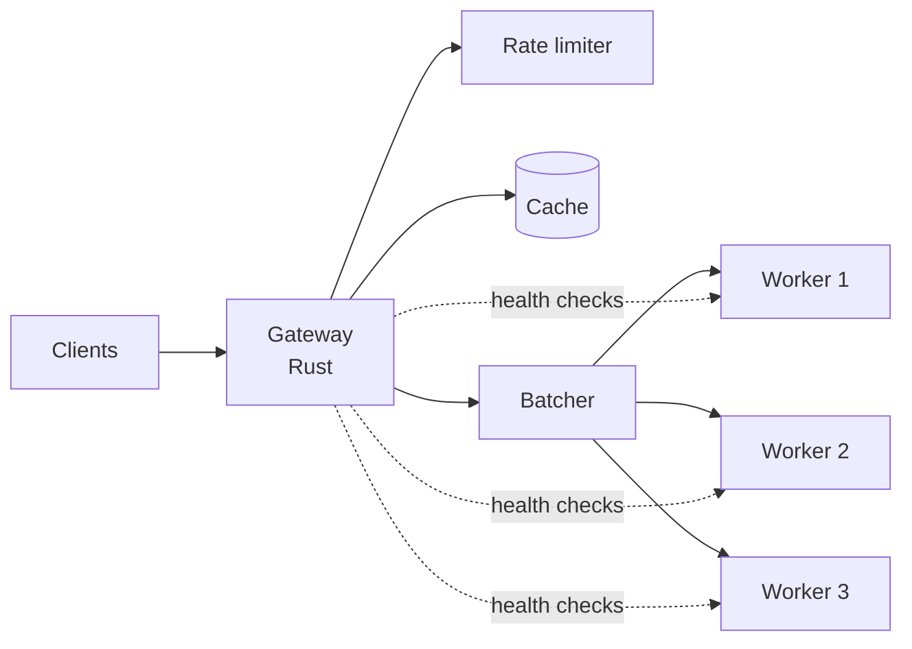

# verdict

Rust serving platform for a from-scratch, calibrated decision model, built and measured in stages to explore system design trade-offs.

> **Status:** In progress: Phase 0 (setup). Nothing below the roadmap is built yet; benchmark tables fill in as milestones complete.

## What it is

Most language models generate text. This one makes **decisions**: you send some input plus a set of declared answer options, and it returns a probability for each option in a single forward pass.

```
"Customer says the payment failed twice and they need it fixed today."
  → billing: 0.87   technical: 0.11   account: 0.02
```

The project has two halves:

1. **The serving system** — a Rust gateway in front of a pool of inference workers, with caching, load balancing, health checks, rate limiting and dynamic batching. Built first against fake workers, then deployed to the cloud.
2. **The model** — a small transformer trained from scratch in Python, pretrained on next-token prediction and then given a decision head that outputs calibrated probabilities. Served from Rust via [`candle`](https://github.com/huggingface/candle) behind the same contract the fake workers use.

Every design decision is measured. The [design doc](docs/DESIGN.md) records what was built, which alternatives were rejected, and the numbers behind each choice.

## Architecture



Workers are interchangeable behind the `/decide` contract:

| Stage | Worker implementation |
| --- | --- |
| Now | Fake worker — simulates single-pass latency that scales with input length and option count |
| Later | Real model — from-scratch transformer with a decision head, served via `candle` |

## The `/decide` contract (v1)

This contract stays fixed when workers are swapped, so the gateway never changes. Workers and the gateway both speak it.

`POST /decide` with `content-type: application/json`.

### Request

```json
{
  "input": "Customer says the payment failed twice and they need it fixed today.",
  "question": {
    "type": "choice",
    "options": ["billing", "technical", "account"]
  }
}
```

| Field | Rules |
| --- | --- |
| `input` | String, 1–8,192 bytes (UTF-8) |
| `question.type` | One of `choice`, `yes_no`, `score` |

Unknown fields are ignored, so optional fields can be added later without breaking older clients.

### Question types

| Type | Fields | Options, in declared order | Example |
| --- | --- | --- | --- |
| `choice` | `options`: 2–32 unique, non-empty strings | As listed | Which team should handle this ticket? |
| `yes_no` | None | `yes`, `no` | Is this message urgent? |
| `score` | `min`, `max`: integers (may be negative), with 1 ≤ `max` − `min` ≤ 10. Optional `labels`: exactly `max` − `min` + 1 strings, one per point from `min` upwards | Each integer from `min` to `max` | How positive is this review? |

Score request:

```json
{
  "input": "Arrived a day late but works perfectly. Would buy again.",
  "question": {
    "type": "score",
    "min": 1,
    "max": 5,
    "labels": ["terrible", "bad", "ok", "good", "great"]
  }
}
```

`labels` describe what each point means. They are passed to the model and do not change the response shape.

### Response

```json
{
  "type": "choice",
  "probabilities": {
    "billing": 0.87,
    "technical": 0.11,
    "account": 0.02
  },
  "answer": "billing",
  "model": "fake-v0",
  "latency_ms": 212
}
```

| Field | Rules |
| --- | --- |
| `type` | Same as the request's `question.type` |
| `probabilities` | One entry per option, each between 0 and 1, summing to 1 (±0.001). For `score`, keys are the integers as strings, e.g. `"1"` … `"5"` |
| `answer` | The most probable option, always a string that is a key of `probabilities`. Ties go to the first option in declared order: the first listed for `choice`, `yes` for `yes_no`, the lowest value for `score` |
| `expected` | `score` only. The probability-weighted mean of the scale, as a number |
| `model` | Non-empty string naming the model that answered |
| `latency_ms` | Time the worker spent on the request, in milliseconds, as a non-negative number |

Score response:

```json
{
  "type": "score",
  "probabilities": { "1": 0.02, "2": 0.03, "3": 0.10, "4": 0.45, "5": 0.40 },
  "answer": "4",
  "expected": 4.18,
  "model": "fake-v0",
  "latency_ms": 198
}
```

`answer` is the single most likely value; `expected` summarises the whole distribution. When they disagree a lot, for example on a split 1-or-5 opinion, read `probabilities`.

### Errors

Every error response has the body `{"error": "<human-readable message>"}`.

| Status | When |
| --- | --- |
| `400 Bad Request` | The body is not valid JSON |
| `415 Unsupported Media Type` | `content-type` is not `application/json` |
| `422 Unprocessable Entity` | Valid JSON that breaks a rule above: wrong field types, an unknown `type`, `min` ≥ `max`, a range over 11 points, a `labels` length mismatch, fewer than 2 or more than 32 options, duplicate options, or `input` outside 1–8,192 bytes |
| `502 Bad Gateway` | Gateway only: no worker could be reached |
| `504 Gateway Timeout` | Gateway only: the worker did not answer in time |

### Clarifications

- **`expected`** is computed from the probabilities as returned, so a client can reproduce it from the response. It must match within ±0.001. It is absent, not `null`, for `choice` and `yes_no`.
- **Ties** are exact equality only: 0.4 and 0.40000001 are not tied.
- **`input` length** is measured in UTF-8 bytes of the decoded string, not characters: 4,096 `é` is 8,192 bytes.
- **`min` and `max`** must be between -128 and 127
- **`min` and `max`** must be JSON integers; `1.0` is rejected with 422.
- **Duplicate options** are exact, case-sensitive matches: `"Billing"` and `"billing"` are different options.
- **`labels`** must be non-empty and unique. `"labels": null` is the same as leaving the field out.
- **Missing required fields** (`input`, `question`, `options`, `min`, `max`) are rejected with 422.
- **Unknown fields** are ignored everywhere, including an `options` field on a `yes_no` question.
- **`content-type`** parameters are accepted: `application/json; charset=utf-8` is valid.
- **Key order** in `probabilities` is not meaningful. "Declared order" only decides ties.
- **When several rules break**, the first applicable error wins: 415, then 400, then 422.
- **Error responses** are served as `application/json` and always contain a non-empty `error` string. Other fields may be added later; clients should ignore fields they don't recognise.

## Roadmap

### Phase 1 — Rust foundations
- [ ] Rust Book (core chapters) and Tokio tutorial

### Phase 2 — Local systems project
- [ ] **M1** Gateway forwards to one fake worker; baseline throughput and p50/p99 latency
- [ ] **M2** Response cache with expiry
- [ ] **M3** Three workers, round-robin load balancing, health checks
- [ ] **M4** Token-bucket rate limiter
- [ ] **M5** Containerised with Docker Compose
- [ ] **M6** Dynamic batching
- [ ] Design doc v1

### Phase 3 — Cloud
- [ ] **M7** Single-VM deployment
- [ ] **M8** Gateway and workers split across machines
- [ ] Design doc v2

### Phase 4–5 — The model
- [ ] Pretrain a tiny transformer
- [ ] Decision head and fine-tuning on Choice / Yes-No / Score data
- [ ] Calibration (reliability diagram, expected calibration error, temperature scaling)
- [ ] Serve via `candle` behind `/decide`; re-run all benchmarks

## Results

Filled in as each milestone completes. No numbers appear here until they've been measured.

| Milestone | Metric | Result |
| --- | --- | --- |
| M1 Baseline | Throughput / p50 / p99 | — |
| M2 Cache | p50 at 0% / 50% / 90% hit rate | — |
| M3 Failure | Error rate and recovery time when a worker dies | — |
| M4 Rate limiting | p99 for normal traffic under overload | — |
| M6 Batching | Throughput vs p99 across batch wait times | — |
| M7–M8 Cloud | Local vs single-VM vs multi-machine | — |

## Running locally

_Available from M5. Planned:_

```bash
git clone https://github.com/AnhadPahwa/verdict
cd verdict
docker compose up
```

## Repository layout

```
Cargo.toml      Workspace root
CLAUDE.md       Rules for Claude Code in this repo
gateway/        Rust gateway: routing, cache, rate limiting, batching
worker-fake/    Rust fake worker implementing /decide
docs/           Design doc and diagrams
```

Added when the relevant milestone starts:

```
bench/          Load-test scripts and raw results (M1)
worker-model/   Rust worker serving the trained model via candle (Phase 5)
training/       Python: pretraining, decision head, calibration (Phase 4)
```

## Tech stack

- **Rust** — gateway and inference workers (`tokio`, `axum`, `candle`)
- **Python** — model training (PyTorch)
- **Docker Compose** — local multi-service setup
- **AWS** — cloud deployment

## How this was built

Core logic (request forwarding, caching, rate limiting, batching and model code) is written by hand. [Claude Code](https://claude.com/claude-code) is used for configuration, Dockerfiles, CI, test and benchmark scripts, infrastructure, and code review. The split is enforced in [`CLAUDE.md`](CLAUDE.md).

## License

MIT